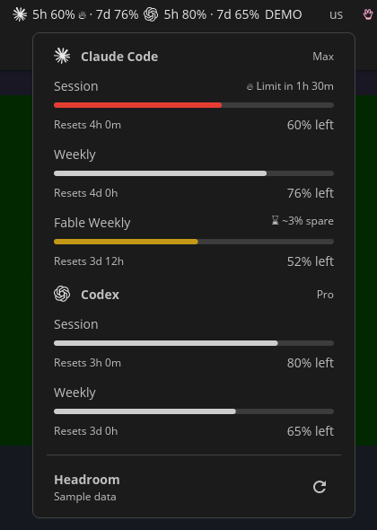

# Headroom for the COSMIC panel

Claude Code and Codex quotas in the COSMIC top panel, with reset countdowns and forecasts: the
same numbers and the same wording as the GNOME extension, drawn by a native COSMIC applet.
Built and tested on **Pop!_OS 24.04, COSMIC 1.10.0**.



## Install

From this folder's parent (the repository root):

```sh
cosmic/install.sh --panel
```

That builds everything, installs it for your user only (nothing needs sudo) and adds Headroom
as the first applet on the right of the top panel. Run `cosmic/install.sh` again after a change
to rebuild and restart it; `cosmic/install.sh --remove` takes it out again.

It needs `cargo` (rustup picks the toolchain named in `applet/rust-toolchain.toml`),
`libxkbcommon-dev`, `libwayland-dev`, `pkg-config`, `gjs` and `python3`. As with the GNOME
extension, you only have to be logged in to Claude Code and/or Codex on this computer.

## Use

- The panel shows each provider's mark and its numbers, for example `7d 79%`, or
  `5h 96% · 7d 79%` with both windows turned on.
  `!` marks an old reading and a flame a window that is on course to run out.
- Click it for every quota window: a meter, the reset countdown and the forecast.
- The round arrow asks for an update now (at most one every 20 seconds). Otherwise it updates
  every five minutes.

## Settings

There is no settings window yet. Without a settings file it starts the way the GNOME extension
does: Claude Code and Codex, the weekly window in the panel, shown as what is left. To change
that, write a small file, `~/.config/headroom/cosmic.json`; it is read again whenever it
changes. For example, Claude only, with the 5-hour window beside the weekly one:

```json
{
  "providers": ["claude"],
  "barWindows": ["session", "weekly"],
  "display": {"claude": "remaining"}
}
```

- `providers`: which to show, in order: `"claude"`, `"codex"`. Default: both.
- `barWindows`: which windows the panel shows: `"session"`, `"weekly"` or both. Default: weekly.
- `display`: per provider, `"remaining"` (what is left, the default) or `"used"`.
- `"demo": true` shows sample data and stops live collection.

## How it is put together

Nothing in the shared code or under `gnome/` changes for this.

- `ViewModel.js`: what to draw, as plain data, worked out with the shared `Model.js` and
  `Pace.js`. Pure; tested by `tests/viewmodel.test.cjs` (`node --test cosmic/tests/`).
- `headroom-view.js`: a small GJS program that runs `gnome/UsageService.js` (and so the same
  collectors) and prints one JSON line each time what should be on screen changes.
- `applet/`: the COSMIC applet (Rust, libcosmic, pinned to the revision COSMIC 1.10.0 ships). It
  keeps `headroom-view.js` running and only draws.
- `build.py` assembles the data folder the way `gnome/build.py` does; `install.sh` installs it
  to `~/.local/share/headroom-cosmic` and the applet to `~/.local/bin/cosmic-applet-headroom`.

## Not here yet

- A settings window (the file above stands in for it).
- The cost estimates section.
- The forecast marker on the meters, and their hover text.
- Panels on the left or right edge of the screen: the layout assumes a top or bottom panel.

## One thing worth knowing

The panel button holds its text still while its own popup is open and catches up when the popup
closes. If the button changes width under the pointer while its popup is open, the COSMIC panel
takes that for the pointer moving to another applet and opens that applet's menu instead. The
popup itself always shows the latest reading.
